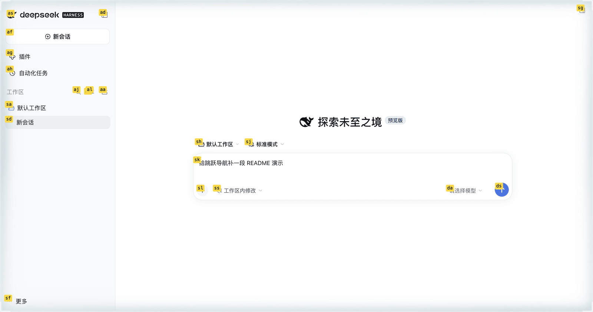

# dsh-jump


Keyboard jump navigation for the DeepSeek Harness Web GUI: press the click or
focus chord, type a letter label, and the labelled element is clicked or
focused.

[](https://www.npmjs.com/package/dsh-jump)
[](./LICENSE)
[](https://github.com/topics/dsh-plugin)

[](https://dsh.fish/a/dsh-jump)
[](https://dsh-plugin.org/plugins/lionad-morotar/dsh-jump)
[](https://dshopen.org/plugins/dsh-jump)



[中文](#中文) · [Install](#install) · [What gets labelled](#what-gets-labelled) · [How labels are assigned](#how-labels-are-assigned) · [Performance](#performance-on-a-busy-page) · [Frame budget bench](#frame-budget-bench) · [v1 boundaries](#v1-boundaries) · [Layout](#layout)

## Install

### From npm

```
dsh plugin --profile web add dsh-jump
```

The package on npm is `dsh-jump`. Restart the profile afterwards; the bundle
patch registers its Loader row, so no manual `cordis.patch.yml` edit is needed.

### From a checkout

To track this repository instead of the published version:

```json
{
  "dependencies": {
    "dsh-jump": "link:../dsh-jump"
  },
  "dsh": {
    "profile": {
      "bundles": ["...", "dsh-jump"]
    }
  }
}
```

Then `dsh plugin --profile web install` and restart DSH. The path in `link:`
resolves relative to `~/.dsh/profiles/web`, so adjust it to wherever the
checkout lives on your machine. Pointing at a git URL works too:
`dsh plugin --profile web add github:Lionad-Morotar/dsh-jump`.

### Manual patch

Append to the profile's `cordis.patch.yml`:

```yaml
- insert:
    - id: jump
      name: 'dsh-jump'
```

The top level of that file must always stay a YAML array (`[]` when empty).

## 中文

给 DeepSeek Harness Web GUI 的键盘跳跃导航：按下点击或聚焦的组合键，视口里的可交互元素
会被打上字母标签，再敲标签即可点击或聚焦到它。

- `Cmd+H` 进入点击模式；非 Mac 上是 `Ctrl+H`。`Esc`（或任意 meta 组合键、或再按
  一次激活键）退出。
- 聚焦模式与引用模式默认未启用，没有和弦就没有按键能打开它们。要开启就进
  设置 → 「跳跃导航」，点该行的快捷键再按一个组合键；行内另有「关闭」把它解绑
  回未启用，「恢复默认」对这两行同样是解绑（它们没有出厂和弦可回）。点击模式
  始终保留一个和弦。
- 组合键都可以改：点一下快捷键再按新的即可立即生效，无需刷新。绑定存在浏览器的
  `localStorage`（`dsh-jump:bindings:v1`），不写进包配置。
- `Insert`、`F1`、`Home` 这类不产生字符的键可以不配修饰键。它们在输入框里
  仍然归输入框：焦点在可编辑区域时裸键不触发，带修饰键的组合键照旧生效。
- 这一页在设置导航里排第 25 位。位置由注册时声明的 `order` 决定；宿主占用
  -10 / 0 / 10 / 15 / 20，已装第三方从 30 起。改这个值时先重新扫一遍，
  两个插件取同一个 `order` 时谁在前取决于注册先后，不受控。
- 标签前九个是 `a s d f g h j k l`；超过九个时整轮改用等长的双键标签（`as`、`ad`
  ……），避免短标签抢走长标签的首击；超过 81 个则整轮升到三键。
- 激活时先放掉当前焦点，再采集标签。焦点留在输入框里时，下一击会被输入法吃掉；
  放掉之后，从输入框和从按钮激活是同一条路。
- macOS 上，激活还会记住当前输入源并切到美式键盘（`com.apple.keylayout.ABC`）。
  `Esc`、打完一个标签、切到别的应用、或插件卸载时还回去。切换由宿主进程调用本机的 `im-select`
  完成，页面本身切不了输入法。二进制不在、或宿主没有 web 服务时，这一步跳过，
  标签模式照常打开。
- 命中的元素决定动的含义：文本输入面（textarea、带光标的 input、
  `contenteditable`）聚焦并把光标落到草稿末尾，其余元素在点击模式下走完整的
  合成指针/鼠标/点击序列，聚焦模式下只调 `focus()`。

## Compatibility

`engines.dsh` is `>=0.2.0-rc.2 <0.3.0-0`. An own `engines.dsh` range decides
alone: the host ignores `peerDependencies` once it is present, and prereleases
participate in the range, so 0.2 release candidates are admitted while 0.3 is
not.

## Display metadata

The plugin manager reads `locale/en.json` and `locale/zh.json` for the title and
one-line description without evaluating the plugin, and resolves the icon
through `exports["./icon"]` as an SVG served as a `data:` URL.
`assets/icon-180.png` is the same artwork rendered at 180px for GitHub-hosted
catalog entries, which reject SVG.
## What gets labelled

Three families, each added because a real element was unreachable:

- Native controls — `a[href]`, `button`, `input`, `select`, `textarea`,
  `summary` — plus anything carrying a `tabindex`.
- ARIA widget roles the Harness actually renders: `button`, `link`, `tab`,
  `treeitem` (the sidebar's project and session rows), `option`, the
  `menuitem*` family, `checkbox`, `radio`, `switch`, `slider`, `spinbutton`.
  Structural roles (`row`, `columnheader`, `gridcell`) are deliberately
  absent: a row is a container and a header is a label, so labelling them
  hands dead labels to every presentational table; an interactive grid gives
  its cells a `tabindex`, which the branch above already catches.
- Editable hosts (`[contenteditable]:not([contenteditable=false])`) and the
  text-entry roles `textbox` / `searchbox` / `combobox`. This is what makes
  the composer reachable: it is a Lexical-managed
  `div[contenteditable=true][role=textbox]` with no tag and no `tabindex`, so
  no native selector matches it. `contenteditable=false` is excluded on
  purpose — Lexical marks chips and command tokens inside the composer with
  it, and the deepest-candidate rule would otherwise let a chip steal the
  label from the composer that owns it.

## How labels are assigned

Labels follow the eye, not the DOM. Candidates are clustered into rows by
vertical overlap, rows are ordered top to bottom, and each row is consumed left
to right, so a row rendered right-to-left in the markup still reads `as`, `ad`
from the left edge. Nothing about this is remembered: the same page always
produces the same order.

An element keeps the label it had last round. After each round the plugin
records which label each element carried, keyed by the element's identity (an
explicit `data-row-key`, the composer marker, or a `data-slot` boundary plus the
control's accessible name and tag). The next round hands a remembered label
back to its element first, and the remaining labels fill the gaps, so a button
that appears above the one you use does not push its label onto a neighbour.

Memory is spent only when it is unambiguous. A remembered label is ignored when
its length differs from the round's label length, and when two candidates share
one identity both are dropped rather than guessed. The table holds 64 entries
for the current page load and evicts the entry that has gone longest without a
hit. It is never written to `localStorage` or `sessionStorage`, so a reload
starts with no memory and labels are assigned fresh.

## Click versus focus is decided by the target

Both activation modes jump to the same set, and the matched element decides
what "jumping" means. Click mode ships bound; focus mode ships unbound, so a
reader who wants it records a chord on its settings row first:

- Text entry surfaces (textarea, caret-bearing inputs, contenteditable hosts)
  are focused, and the caret is collapsed to the end of the draft so the next
  keystroke continues writing. A field that already owns the caret keeps its
  offset.
- Everything else gets the full synthetic pointer/mouse/click sequence in
  click mode, and a plain `focus()` in focus mode.

The split is not stylistic. Synthetic pointer and mouse events are untrusted,
so the browser performs no focusing default action for them: dispatching the
whole sequence at a button, an input and a contenteditable element left
`activeElement` unchanged in all three cases. Conversely a button does
nothing when focused. Mode therefore only picks the fallback; the target picks
the action.

Labels are rendered as an overlay by the client entry; while jump mode is
active all keydown events are consumed by the state machine, so typing inside
a focused input never leaks through.

Activation blurs the focused element before it collects labels, so a letter
typed next is a label even when the chord was pressed inside a text field. On
macOS the host process also remembers the current input source and switches to
`com.apple.keylayout.ABC` for the round, then switches back on Escape, on a
completed label, or when the plugin unloads. The page cannot do this itself;
it asks the host over `POST /api/dsh-jump/ime`, and the host runs `im-select`.
A missing binary or a host without a web server skips the switch. Labels still
appear. `im-select` is a machine dependency, not a package dependency: install
it yourself (`brew install im-select`) if you want the switch.

## Reference mode

A third activation mode, off by default. It uses the same label round as the
other two, but picking a label does not click and does not move focus: it
inserts a description of the element into the current session's composer as a
structured chip.

- **Off until recorded.** Reference mode ships unbound, so no chord is taken
  from the host on install. It is the third row of the Jump navigation settings
  section (`settings.section`, id `jump`, order 25), under click and focus. That
  row shows "Off" instead of a chord; its chord button starts recording, and a
  "turn off reference mode" control unbinds it again. Restoring that row means
  unbinding, not falling back to a shipped chord, because it has none.
- **Nothing on the page changes.** The reference branch is checked before the
  target's own activation, so neither the synthetic click sequence nor the
  focus path runs. The element keeps whatever selection and focus it had.
- **The chip.** `clipboardText` is `[ui element button#gx-reference]` or
  `[ui element button[data-testid=gx-reference]]`; the label is
  `button「引用」`. The model text is one line of facts:
  `[ui element] <button> data-testid="gx-reference" role=button aria-label="引用" class="gx-btn" text="引用"`.
  Identity priority is `data-testid` > `id` > up to three authored classes; a
  class counts as authored when it carries a `-` or `_` and is not a utility
  word or a generated hash (`css-…`, `sc-…`, `_…`).
- **It needs a session.** The plugin is root-level, so it cannot ask which
  session is on screen. An invisible entry in `conversation.input.overlay`
  publishes `{ sessionId, inputActions }`; with no session, or on a host
  without that slot, the insert answers `no-session` and nothing is clicked.
- **Degrades, never throws.** A host without `insertReference`, or one whose
  trigger source never registered, falls back to
  `inputActions.insertText(clipboardText)`: the plain text is still sendable,
  whereas a chip with no codec would be refused at send time and keep the
  draft. If neither channel accepts the write the pick is silently dropped
  rather than escalating into a click.
  `inputTriggers`, `sessions` and `conversation` are all soft-probed, so a host
  missing any of them keeps the navigation and loses only the chip's send-time
  identity.
- **Clicking the chip goes back to the element.** The chip carries a
  description rather than a live reference, so the element is looked up again
  on every click, in the same order the description was written in:
  `data-testid` > `id` > tag plus its authored classes > `role` / `aria-label`
  > visible text. The identity steps search the whole document: a live
  `data-testid` wins even when the element's tag changed since the chip was
  written, and an `id` is matched without consulting the tag. Only the weaker
  steps stay inside the original tag's candidate list. Each step is exhausted
  before the next one starts, so a stale `id` elsewhere on the page cannot beat
  a live test id.
  A hit is scrolled to the centre of the viewport and focused with
  `preventScroll`, which keeps the focus from undoing the centring. The
  composer is never a candidate: it is `contenteditable` and its text can hold
  the very words the target carried, so revealing it would scroll to the chip
  the reader just clicked and call that a success. A miss answers `false` and
  the host keeps its own gesture.

## Performance on a busy page

A round is two stages with different costs, and neither grows with the square
of the page. Collection is an interruptible walk: the activation frame scans
only as many candidates as fit in a fraction of the display frame, and later
frames resume from where the walk stopped. Labels cannot be issued until the
total count and the visual order are known, so stage B assigns every label and
paints the whole batch once, at the end of the scan. Neither stage is on the
critical path of a stroke:

- The candidate walk is interruptible and budgeted. Every slice checks the
  clock before the next candidate and returns to the next animation frame when
  its share of the frame is spent, so a 600-candidate page pays a small slice
  on the activation frame instead of the whole page. A slice is 12% of the
  measured display budget, clamped to 0.4-1.5ms.
- The display budget is measured at runtime, not assumed. An idle callback
  samples 24 animation frames (about 170ms at 143Hz, 400ms at 60Hz) and caches
  the median, rounded up to 0.1ms. Until the sample lands the slice is computed
  from a conservative 8ms budget, not the 60Hz fallback: a 143Hz panel must
  never be handed a 16.7ms slice in the window where the sample is still
  running. A hidden page starts no sample and a page hidden mid-sample abandons
  it; a viewport resize drops the cached value and samples again, because an
  external monitor can change the refresh rate; a median outside 4-40ms is
  treated as unmeasurable and 16.7ms is used.
- Stage B is pure array work. Sorting the candidates into reading order and
  assigning one label length for the whole round never reads layout or style,
  which is what keeps the last slice cheap even on a busy page.
- Badges live on one canvas, not in the DOM. A stroke repaints the round in
  place: the lit/dim split is a function of the typed prefix, so a full redraw
  of 600 badges measured 1.7ms including a forced GPU read, against 32.8ms for
  the DOM round. There is no per-badge node, no containing-block bookkeeping
  and no style invalidation for the host page.

The quantity that answers "how much of a frame does the plugin take" is the
plugin's own probe: every stage A collect slice and every paint is timed with
two `performance.now()` reads and flushed as one frame-aligned pair. That is
the acceptance input. Event Timing and LoAF are retained as coarse
corroboration only: Event Timing floors observation at 16ms, and LoAF reports
only frames over 50ms, so neither can see a 2ms handler on a 7ms display.
`timeToUsable` remains a diagnostic: the wall clock from the activation
dispatch returning to every label of the round being painted, plus the
animation frames observed in that wait. A background tab throttles animation
frames and inflates the wall clock, so the frame count is the steadier relative
number; `activate.handlerMs` adds the synchronous dispatch cost when the full
keypress-to-typing span is wanted.

Labels are fixed for the whole round: label, target and rect are snapshotted
when the round opens, so only the prefix can change inside a round. A new round
mints new labels, which is what stops a label from staying over a target that
has moved since.

## Frame budget bench

`bench/measure.mjs` produces the plugin's own per-frame occupancy, plus two
coarse corroboration readings: long frames attributed to the plugin bundle and
the latency of a real activation keydown. The plugin probe is the acceptance
input because only the plugin can see its 1-2ms synchronous work: LoAF has a
50ms floor and Event Timing a 16ms floor, both far above a 7ms frame budget.
The bench bundles `src/client/app.ts` with the repo's own esbuild into one
browser IIFE, writes the measurement page and its external bundle side by
side, and prints both paths:

```sh
node bench/measure.mjs                              # or: pnpm bench
node bench/measure.mjs --candidates 80,300,600,1200 --runs 60
node bench/measure.mjs --runs 60 --warmup 10 --label before
node bench/measure.mjs --out temp/bench.html        # keep the page somewhere
node bench/measure.mjs --label before --archive temp/bench-runs  # save raw JSON
node bench/measure.mjs --verify-fresh               # refuse any reused result
node bench/measure.mjs --no-browser                 # generate the page only
node bench/measure.mjs --check                      # CI-safe self-check, no browser
```

The bundle is a separate `<script src>` next to the page, never inlined. LoAF
attribution only reports a `sourceURL` for an external script; an inline bundle
would make the corroboration reading empty.

When a local Chrome is found, the script drives it over the DevTools protocol
and gives every candidate tier a brand-new browser context: a new target, new
storage and a new JS realm, navigated to the page with a random query string.
Before a reading is accepted, the driver checks that this document was reached
by a navigation (`performance.getEntriesByType("navigation")[0].type ===
"navigate"`), that its `timeOrigin` matches the tier it just ran, and that the
result carries the same random run token. This is what makes two runs of the
same source comparable: one tier can never read the previous tier's
`window.__BENCH_RESULT__`. The driver also answers the page's trusted-input
requests with real CDP key events, because Event Timing ignores synthetic
events. When Chrome is missing, or `--no-browser` is passed, the script only
generates and prints the page, then exits 0 and asks for a real browser. Serve
that page over HTTP and open it in a foreground tab; the page clears
`window.__BENCH_RESULT__` on load, so a second run in the same tab cannot read
the first one's JSON.

Headless Chrome with `--disable-gpu` draws the canvas through software raster,
which is exactly the part whose cost differs from a GPU-composited page. The
probe still measures the plugin's own synchronous work, so it gives a usable
regression signal; treat headless numbers as a smoke test rather than GPU
acceptance evidence. Each tier stamps `judgeable`: true when the display budget
is finite and `app.perfStats()` produced at least one frame sample, false
otherwise. A non-judgeable tier reports `verdictAttributed: "smoke-only"`
instead of `pass` or `fail`. LoAF and Event Timing can be empty on a fast
machine and no longer affect judgeability. Open the same generated page in a
real foreground tab when the question is acceptance.

For each candidate tier the page lays out a viewport-filling grid of visible
buttons, runs `min(10, runs)` full activate → first stroke → Esc cycles, and
discards their readings. Every activation waits until `app.visibleLabels()`
holds the expected number of painted labels before the page reads them or sends
the first label stroke: `app.labels()` is complete the moment stage A commits,
so it would call a round usable while the canvas is still painting it, and a
fixed frame count would measure a prefix of the round. The wait is bounded at
200 animation frames or 3 seconds and fails the tier with `collection did not
settle` instead of silently comparing a half-round. Warmup is still required:
without it the first tier pays JIT compilation, first layout and GC warmup and
reports a cold start as a tier cost, so `--warmup <n>` only tunes the count.
Then it times `runs` complete activations, `runs` first label strokes, `runs`
second label strokes, `runs` complete labels (each on a fresh activation) and
one Esc exit on a fully inserted round. The second stroke is the phase where
the dimmed batch matters: on a three-key label it must stay untouched while the
live prefix splits further (on a two-key tier it is the completing stroke). The
close reading reports the label count it tore down as `nodes`.

### The acceptance criterion

A tier's `verdictAttributed` is `pass` exactly when
`pluginFrameMs.p99 <= frameBudgetMs * 0.5`.

`app.perfStats()` returns the plugin's own frame-aligned occupancy:
`samples.collect` times each stage A slice, `samples.paint` times each canvas
paint, and both arrays carry one entry per observed frame, so index i of each
belongs to the same frame and the two values can be added. A frame that runs
only one stage contributes 0 to the other array. `frames` counts every observed
frame while the arrays keep the latest 512, dropping the oldest first. The
measured window starts at the warmup boundary, so cold-start paints and JIT
cycles stay out of the acceptance reading. The probe costs two
`performance.now()` reads per stage, allocates nothing per frame in steady
state, never logs or serializes, and is on by default. A host
can turn it off with `deps.perfProbe: false`; `perfStats()` then reports empty
samples and the bench cannot judge that tier.

`pluginFrameMs` is the per-frame sum of the two arrays, summarized to
`p50`/`p99`/`max` with nearest rank. `pluginCollectMs` and `pluginPaintMs`
repeat the same summary for each stage separately. If a host ever reports
arrays of different lengths they are not frame-aligned; the combined reading is
then null instead of pairing by index, and only the separate summaries stand.
That is also why the two arrays are flushed as pairs rather than appended per
call: per-call appends cannot be aligned without inventing frames neither stage
observed.

LoAF and Event Timing stay in the JSON as `loafEvidence` and
`eventTimingEvidence`, each with a note saying it is coarse corroboration only.
LoAF observes only frames over 50ms, so a 2ms plugin handler on a 7ms display
produces no entry; when it does fire, only `scripts` whose `sourceURL` path is
the generated bundle are summed, and frames with no plugin script are counted
as `excludedLongFrames` instead of being blamed on the plugin. Event Timing
floors observation at 16ms even with `durationThreshold: 0`, so a fast
activation leaves no sample; it reports `p50`/`p95`/`max` of the keydown's
input-to-next-paint `duration` when samples exist, with `trustedActivations`
showing how many came from real key input rather than `dispatchEvent`. Neither
observer can decide the verdict anymore.

The old differential verdict is kept for trend reading but no longer decides
acceptance. It compares the active over-budget rate with a blank control window
on the same tier. That comparison cannot answer whether the plugin ran in the
hitched frame: a blank page on this machine already misses 45-50% of 7ms frames
under `fileproviderd` load, so the difference between two unstable rates is
mostly noise, and the gate fails with zero plugin work. `verdictLegacyNote`
states this in every tier and in the protocol block.

The tier fields are:

- `frameBudgetMs`: the display budget the app used for this tier. It runs 240
  animation frames under a continuous animation and takes the median gap,
  rounded up to 0.1ms, so a 143Hz panel reports about 7.0 rather than a nominal
  60/120/144 constant. The bench injects this measurement into `createApp`, so
  the plugin and the gate talk about one budget.
- `budgetSource`: where that number came from: `injected` (the bench),
  `published` (a host global), `measured` (the plugin's own sample) or
  `fallback` (the conservative 8ms / 60Hz assumption).
- `pluginFrameMs`: `p50`, `p99`, `max`, `samples` and `aligned` of the
  per-frame collect plus paint sum. This is the acceptance input.
- `pluginCollectMs` and `pluginPaintMs`: the same shape for each stage alone.
  Both carry `samples`; `aligned` lives on `pluginFrameMs`.
- `perfFrames`: how many frames the probe observed in total, including frames
  already evicted from the 512-frame window.
- `loafEvidence`: `supported`, `longFrames`, `attributedPluginMs`,
  `attributedForcedLayoutMs`, `attributedFrames`, `excludedLongFrames`, `worst`
  and the coarse-corroboration `note`. `worst` is the longest long-frame entry
  with `duration`, `blockingDuration`, `renderStart` and `startTime`.
- `eventTimingEvidence`: `supported`, `samples`, `durationMs` with
  `p50`/`p95`/`max`, and the coarse-corroboration `note`.
- `trustedActivations`: how many of the tier's activations were driven by real
  key input rather than `dispatchEvent`. It is the evidence behind an Event
  Timing sample.
- `verdictAttributed`: `pass`, `fail`, `smoke-only` or `stale`. Only a
  judgeable tier can pass or fail; `--verify-fresh` marks an unprovable result
  `stale` exactly like the legacy verdict.
- `judgeable`: true when the display budget is finite and `pluginFrameMs` has
  at least one sample. LoAF and Event Timing are not part of this decision.
- `verdict`: the legacy differential verdict, kept for trend reading.
  `verdictLegacyNote` explains why it is not acceptance.
- `maxFrameMs`, `overBudgetFrames`, `overBudgetPct`, `idleFrameBudgetMs`,
  `idleOverBudgetFrames`, `idleOverBudgetPct`, `excessOverBudgetPct` and
  `noiseBandPct`: the raw differential inputs, unchanged so the old trend line
  can still be recomputed by hand.
- `timeToUsable`: how long a reader waits before the first label stroke can
  land. `ms` carries p50/p95/max of the wall clock from the activation
  dispatch returning to every label of the round being painted; `frames`
  carries p50/max of the animation frames observed in the same wait. This is a
  historical diagnostic: it starts after dispatch and waits for paint, while
  Event Timing starts at the input timestamp and ends at the next paint.

The phase readings are retained unchanged: each phase carries `handlerMs`
(synchronous `dispatchEvent` cost) and `nextFrameMs` (the gap from dispatch
return to the second animation frame), and the phase-level `p50`/`p95` mirror
`handlerMs`. They are useful for tracking a change, but they no longer decide
acceptance. Percentiles use the nearest rank, not interpolation, so any reading
can be recomputed from the samples by hand.

Treat a p95 from fewer than 50 samples as a reference only: at 19 or fewer
samples nearest-rank p95 is literally the maximum, and the bench prints a
样本偏少 warning below 20. The acceptance gate uses p99, which is even more
sample-hungry: a tier with a handful of frames can only report what those
frames did.

`loafEvidence.worst` is the longest long-frame entry recorded during the
measured window: `duration`, `blockingDuration`, `renderStart` and `startTime`
in milliseconds. `loafEvidence.supported` is `false` when the browser does not
expose the entry type; `worst` is then null. Per-frame script attribution is
not copied into `worst`; it lives in `loafEvidence.attributedPluginMs` and
`loafEvidence.excludedLongFrames`.

Every button on the measurement grid lives under `data-slot="bench.grid"` and
carries an `aria-label`, so `identityKey` produces non-empty keys and the label
memory recall and write-back run for real. Each tier reports `identityKeys`
(identity-oracle calls over all activation rounds of that tier),
`identityKeysPerRound` (the measured unit: one activation, through
`collectHints`'s injectable `identity` dependency), `identityRounds` (the
activations actually dispatched) and `identityPath` (`active` only when those
calls produced keys the memory recorded). The per-round count is checked
against `app.labels().length` after the round settles, so a drifted fixture
fails the tier instead of reporting a number nobody measured; `--check` also
proves that a partial read (300 hints against 96 painted labels) is rejected,
and that a round which never reaches its expected count fails with
`collection did not settle` rather than passing as a zero-label round.

`--verify-fresh` makes the freshness contract fatal. The automated Chrome path
already checks every tier; the flag records the requirement in the protocol and
turns any violation into `verdict: "stale"` and `verdictAttributed: "stale"`
with a non-zero exit. The page itself performs the same check at the end of
each tier: `window.__BENCH_RESULT__` must not have existed before the page ran,
the document must have `navigation.type === "navigate"`, and the result
timestamp must be later than the navigation start. In page-only mode the JSON
carries the `stale` verdict even though the process cannot exit for the reader.

`--archive <dir>` writes the aggregated JSON the page produced to
`<dir>/dsh-jump-bench-<label>-<stamp>.json` (stamp in UTC), creating the
directory if needed. The file name carries the label, and an unlabelled run is
archived as `unlabeled`. Two archive runs share one automated protocol, which
is what makes them comparable to each other. Archive mode needs a local Chrome
(`CHROME_PATH` overrides the usual install paths) because the page itself
cannot write files and the repo ships no third-party browser driver.

`--check` needs no browser: it bundles the app, asserts the generated page
still carries every measurement hook (including `perfStats`, `pluginFrameMs`,
`pluginCollectMs`, `pluginPaintMs`, `budgetSource`, `loafEvidence`,
`eventTimingEvidence`, `verdictAttributed`, `judgeable`, `verdictLegacyNote`,
`frameBudgetMs`, `timeToUsable`, `secondStroke`, `close`, `identityKeys` and
`identityPath`), and proves the plugin occupancy arithmetic on a fixed series:
collect and paint pairs add per frame, p50/p99/max are nearest-rank over the
sums, 600 frames keep the newest 512, an empty window reports nulls, and
mismatched array lengths are not added. It also proves the LoAF corroboration
arithmetic (vendor scripts are not summed, a long frame without a plugin script
is excluded, two plugin slices in one frame add up). It pins the
`verdictAttributed` boundaries (p99 at exactly half the budget passes, one
hundredth over fails, a missing plugin sample fails), the `judgeable` rule
(plugin samples decide, a missing budget or empty samples is false), the
percentile and frame-budget implementations, the legacy idle-control
arithmetic, the identity calibration, both settle limits, the freshness
contract, archive naming and a JSON round-trip. It fails if the page or the
script imports anything outside the local toolchain allowlist
(`node:child_process` is there only for the local Chrome driver).

## v1 boundaries

- Hints are snapshotted at the moment of activation: elements that appear or
  move after activation do not get labels until you re-activate.
- The activation chords are stored per browser profile in `localStorage`
  (`dsh-jump:bindings:v1`), not in package config. The host's own shortcut
  registry cannot hold them: a bare home-row label stroke is rejected as
  modifier-less, and the shipped `Cmd+H` default collides with reserved primary
  chords. The listener is therefore plugin-owned, and the settings page writes
  to the same plugin-owned document.
- A chord that prints a character must carry ⌘, ⌃ or ⌥: a bare letter would
  type into whatever field has focus, and Shift alone is refused for the same
  reason. A key that prints nothing (Insert, F1, Home, PageUp) may be bound
  bare; the runtime then steps aside while a text surface has focus, so the
  editor keeps its own meaning of that key. Keys the interface owns (Tab,
  Enter, Space, the arrow keys, Escape) are refused at any modifier count, as
  is the chord the other mode already holds.
- The settings section waits for the host's slot service through `ctx.inject`
  rather than sampling it once. Services start one at a time, so a single
  `ctx.get("slots")` during `apply` can legitimately return undefined; the
  section would then never register, and `ctx.get` reports nothing. With
  neither the slot service nor a React seed, navigation still works; only the
  ability to remap is missing.
- Web and desktop both load this plugin, but the label overlay targets the Web
  GUI's DOM. The chords and the settings section are not Web-specific.

## Layout

- `src/index.ts` host half: serves `POST /api/dsh-jump/ime` and runs `im-select`
- `src/host/input-source.ts` one round: remember, switch to ABC, restore
- `src/host/ime-route.ts` the route, re-attached if the web server appears late
- `src/client/entry.ts` loader adapter: takes the factory's `require`, resolves
  React, then hands the real context to `runtime.ts`
- `src/client/runtime.ts` composition: one bindings store shared by the listener
  and the settings row
- `src/client/hints.ts` hint collection and label stream
- `src/client/target.ts` which action a matched target needs (click vs focus)
- `src/client/keys.ts` key state machine
- `src/client/bindings.ts` chord model, platform defaults, validation, formatting
- `src/client/store.ts` the persisted pair, total on read, normalized on write
- `src/client/recorder.ts` one keydown into a candidate chord
- `src/client/settings-controller.ts` the recording mode's rules, renderer-free
- `src/client/settings-page.ts` the settings page: one row per mode
- `src/client/react.ts` the narrowed React slice and the recording listener
- `src/client/copy.ts` the page's Chinese and English copy
- `src/client/config.ts` selectors and the label key map
- `src/client/ime.ts` the page's begin/end notice to the host route
- `lib/` committed build products (`pnpm run build`)

## Development

```sh
pnpm install
pnpm test        # vitest, 12 files
pnpm typecheck   # tsc --noEmit
pnpm run build   # esbuild src -> lib, committed
```

`lib/` is committed on purpose: an installed profile loads `lib/` straight from
the package and never runs a build step, so the built files have to be in the
tarball and in the repository.

The build produces a two-entry package: `lib/index.js` is the host half (the
input-source route) and `lib/client.js` is the browser half inlined with its
React imports resolved at load time.

## Releasing

```sh
npm version <patch|minor|major>   # or edit package.json
pnpm run release                  # test, build, then publish to registry.npmjs.org
git push --follow-tags
```

`release` runs the tests and the build before publishing, so a failing suite
stops the release. Publishing goes to `registry.npmjs.org` explicitly because a
global `registry` setting elsewhere (a mirror, for instance) would otherwise
send the tarball to the wrong place while reads still succeed.
