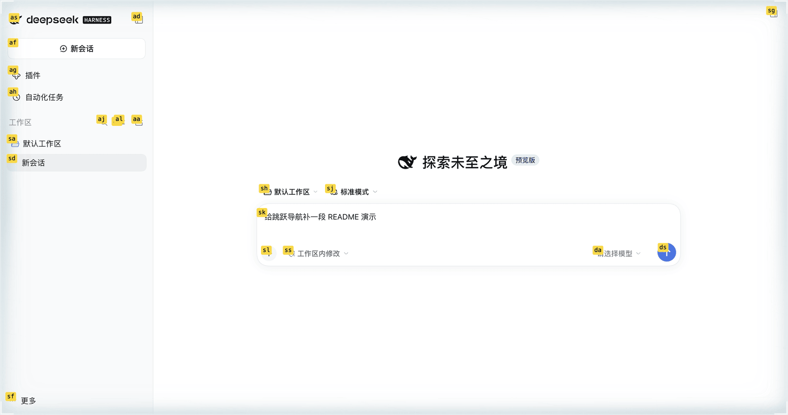

# dsh-jump


Keyboard jump navigation for the DeepSeek Harness Web GUI: press a chord, type a
letter label, and the labelled element is clicked or focused.

[](https://www.npmjs.com/package/dsh-jump)
[](./LICENSE)
[](https://github.com/topics/dsh-plugin)



[中文](#中文) · [Install](#install) · [What gets labelled](#what-gets-labelled) · [v1 boundaries](#v1-boundaries) · [Layout](#layout)

## Install

### From npm

```
dsh plugin --profile web add dsh-jump
```

The package on npm is `dsh-jump`. Restart the profile afterwards; the bundle
patch registers its Loader row, so no manual `cordis.patch.yml` edit is needed.

### From a checkout

To track this repository instead of the published version:

```json
{
  "dependencies": {
    "dsh-jump": "link:../dsh-jump"
  },
  "dsh": {
    "profile": {
      "bundles": ["...", "dsh-jump"]
    }
  }
}
```

Then `dsh plugin --profile web install` and restart DSH. The path in `link:`
resolves relative to `~/.dsh/profiles/web`, so adjust it to wherever the
checkout lives on your machine. Pointing at a git URL works too:
`dsh plugin --profile web add github:Lionad-Morotar/dsh-jump`.

### Manual patch

Append to the profile's `cordis.patch.yml`:

```yaml
- insert:
    - id: jump
      name: 'dsh-jump'
```

The top level of that file must always stay a YAML array (`[]` when empty).

## 中文

给 DeepSeek Harness Web GUI 的键盘跳跃导航：按下一个组合键，视口里的可交互元素
会被打上字母标签，再敲标签即可点击或聚焦到它。

- `Cmd+H` 进入点击模式，`Cmd+U` 进入聚焦模式；非 Mac 上默认是 `Ctrl+H` /
  `Ctrl+U`。`Esc`（或任意 meta 组合键、或再按一次激活键）退出。
- 两个组合键都可以改：设置 → 「跳跃导航」，点一下快捷键再按新的即可立即生效，
  无需刷新。两个模式各有自己的恢复按钮。绑定存在浏览器的 `localStorage`
  （`dsh-jump:bindings:v1`），不写进包配置。
- `Insert`、`F1`、`Home` 这类不产生字符的键可以不配修饰键。它们在输入框里
  仍然归输入框：焦点在可编辑区域时裸键不触发，带修饰键的组合键照旧生效。
- 这一页在设置导航里排第 25 位。位置由注册时声明的 `order` 决定；宿主占用
  -10 / 0 / 10 / 15 / 20，已装第三方从 30 起。改这个值时先重新扫一遍，
  两个插件取同一个 `order` 时谁在前取决于注册先后，不受控。
- 标签前九个是 `a s d f g h j k l`；超过九个时整轮改用等长的双键标签（`as`、`ad`
  ……），避免短标签抢走长标签的首击；超过 81 个则整轮升到三键。
- 命中的元素决定动的含义：文本输入面（textarea、带光标的 input、
  `contenteditable`）聚焦并把光标落到草稿末尾，其余元素在点击模式下走完整的
  合成指针/鼠标/点击序列，聚焦模式下只调 `focus()`。

## Compatibility

`engines.dsh` is `>=0.2.0-rc.2 <0.3.0-0`. An own `engines.dsh` range decides
alone: the host ignores `peerDependencies` once it is present, and prereleases
participate in the range, so 0.2 release candidates are admitted while 0.3 is
not.

## Display metadata

The plugin manager reads `locale/en.json` and `locale/zh.json` for the title and
one-line description without evaluating the plugin, and resolves the icon
through `exports["./icon"]` as an SVG served as a `data:` URL.
`assets/icon-180.png` is the same artwork rendered at 180px for GitHub-hosted
catalog entries, which reject SVG.
## What gets labelled

Three families, each added because a real element was unreachable:

- Native controls — `a[href]`, `button`, `input`, `select`, `textarea`,
  `summary` — plus anything carrying a `tabindex`.
- ARIA widget roles the Harness actually renders: `button`, `link`, `tab`,
  `treeitem` (the sidebar's project and session rows), `option`, the
  `menuitem*` family, `checkbox`, `radio`, `switch`, `slider`, `spinbutton`.
  Structural roles (`row`, `columnheader`, `gridcell`) are deliberately
  absent: a row is a container and a header is a label, so labelling them
  hands dead labels to every presentational table; an interactive grid gives
  its cells a `tabindex`, which the branch above already catches.
- Editable hosts (`[contenteditable]:not([contenteditable=false])`) and the
  text-entry roles `textbox` / `searchbox` / `combobox`. This is what makes
  the composer reachable: it is a Lexical-managed
  `div[contenteditable=true][role=textbox]` with no tag and no `tabindex`, so
  no native selector matches it. `contenteditable=false` is excluded on
  purpose — Lexical marks chips and command tokens inside the composer with
  it, and the deepest-candidate rule would otherwise let a chip steal the
  label from the composer that owns it.

## Click versus focus is decided by the target

Both activation keys jump to the same set, and the matched element decides
what "jumping" means:

- Text entry surfaces (textarea, caret-bearing inputs, contenteditable hosts)
  are focused, and the caret is collapsed to the end of the draft so the next
  keystroke continues writing. A field that already owns the caret keeps its
  offset.
- Everything else gets the full synthetic pointer/mouse/click sequence in
  click mode, and a plain `focus()` in focus mode.

The split is not stylistic. Synthetic pointer and mouse events are untrusted,
so the browser performs no focusing default action for them: dispatching the
whole sequence at a button, an input and a contenteditable element left
`activeElement` unchanged in all three cases. Conversely a button does
nothing when focused. Mode therefore only picks the fallback; the target picks
the action.

Labels are rendered as an overlay by the client entry; while jump mode is
active all keydown events are consumed by the state machine, so typing inside
a focused input never leaks through.

## Reference mode

A third activation mode, off by default. It uses the same label round as the
other two, but picking a label does not click and does not move focus: it
inserts a description of the element into the current session's composer as a
structured chip.

- **Off until recorded.** Reference mode ships unbound, so no chord is taken
  from the host on install. It is the third row of the Jump navigation settings
  section (`settings.section`, id `jump`, order 25), under click and focus. That
  row shows "Off" instead of a chord; its chord button starts recording, and a
  "turn off reference mode" control unbinds it again. Restoring that row means
  unbinding, not falling back to a shipped chord, because it has none.
- **Nothing on the page changes.** The reference branch is checked before the
  target's own activation, so neither the synthetic click sequence nor the
  focus path runs. The element keeps whatever selection and focus it had.
- **The chip.** `clipboardText` is `[ui element button#gx-reference]` or
  `[ui element button[data-testid=gx-reference]]`; the label is
  `button「引用」`. The model text is one line of facts:
  `[ui element] <button> data-testid="gx-reference" role=button aria-label="引用" class="gx-btn" text="引用"`.
  Identity priority is `data-testid` > `id` > up to three authored classes; a
  class counts as authored when it carries a `-` or `_` and is not a utility
  word or a generated hash (`css-…`, `sc-…`, `_…`).
- **It needs a session.** The plugin is root-level, so it cannot ask which
  session is on screen. An invisible entry in `conversation.input.overlay`
  publishes `{ sessionId, inputActions }`; with no session, or on a host
  without that slot, the insert answers `no-session` and nothing is clicked.
- **Degrades, never throws.** A host without `insertReference` falls back to
  `inputActions.insertText(clipboardText)`; if neither channel accepts the
  write the pick is silently dropped rather than escalating into a click.
  `inputTriggers`, `sessions` and `conversation` are all soft-probed, so a host
  missing any of them keeps the navigation and loses only the chip's send-time
  identity.

## v1 boundaries

- Hints are snapshotted at the moment of activation: elements that appear or
  move after activation do not get labels until you re-activate.
- The activation chords are stored per browser profile in `localStorage`
  (`dsh-jump:bindings:v1`), not in package config. The host's own shortcut
  registry cannot hold them: a bare home-row label stroke is rejected as
  modifier-less, and the shipped `Cmd+H` / `Cmd+U` defaults collide with
  reserved primary chords. The listener is therefore plugin-owned, and the
  settings page writes to the same plugin-owned document.
- A chord that prints a character must carry ⌘, ⌃ or ⌥: a bare letter would
  type into whatever field has focus, and Shift alone is refused for the same
  reason. A key that prints nothing (Insert, F1, Home, PageUp) may be bound
  bare; the runtime then steps aside while a text surface has focus, so the
  editor keeps its own meaning of that key. Keys the interface owns (Tab,
  Enter, Space, the arrow keys, Escape) are refused at any modifier count, as
  is the chord the other mode already holds.
- The settings section waits for the host's slot service through `ctx.inject`
  rather than sampling it once. Services start one at a time, so a single
  `ctx.get("slots")` during `apply` can legitimately return undefined; the
  section would then never register, and `ctx.get` reports nothing. With
  neither the slot service nor a React seed, navigation still works; only the
  ability to remap is missing.
- Web and desktop both load this plugin, but the label overlay targets the Web
  GUI's DOM. The chords and the settings section are not Web-specific.

## Layout

- `src/index.ts` host half (empty `apply`; the Loader requires it to resolve)
- `src/client/entry.ts` loader adapter: takes the factory's `require`, resolves
  React, then hands the real context to `runtime.ts`
- `src/client/runtime.ts` composition: one bindings store shared by the listener
  and the settings row
- `src/client/hints.ts` hint collection and label stream
- `src/client/target.ts` which action a matched target needs (click vs focus)
- `src/client/keys.ts` key state machine
- `src/client/bindings.ts` chord model, platform defaults, validation, formatting
- `src/client/store.ts` the persisted pair, total on read, normalized on write
- `src/client/recorder.ts` one keydown into a candidate chord
- `src/client/settings-controller.ts` the recording mode's rules, renderer-free
- `src/client/settings-page.ts` the settings page: one row per mode
- `src/client/react.ts` the narrowed React slice and the recording listener
- `src/client/copy.ts` the page's Chinese and English copy
- `src/client/config.ts` selectors and the label key map
- `lib/` committed build products (`pnpm run build`)

## Development

```sh
pnpm install
pnpm test        # vitest, 12 files
pnpm typecheck   # tsc --noEmit
pnpm run build   # esbuild src -> lib, committed
```

`lib/` is committed on purpose: an installed profile loads `lib/` straight from
the package and never runs a build step, so the built files have to be in the
tarball and in the repository.

The build produces a two-entry package: `lib/index.js` is the host half (an
empty `apply` the Loader still requires to resolve) and `lib/client.js` is the
browser half inlined with its React imports resolved at load time.

## Releasing

```sh
npm version <patch|minor|major>   # or edit package.json
pnpm run release                  # test, build, then publish to registry.npmjs.org
git push --follow-tags
```

`release` runs the tests and the build before publishing, so a failing suite
stops the release. Publishing goes to `registry.npmjs.org` explicitly because a
global `registry` setting elsewhere (a mirror, for instance) would otherwise
send the tarball to the wrong place while reads still succeed.
