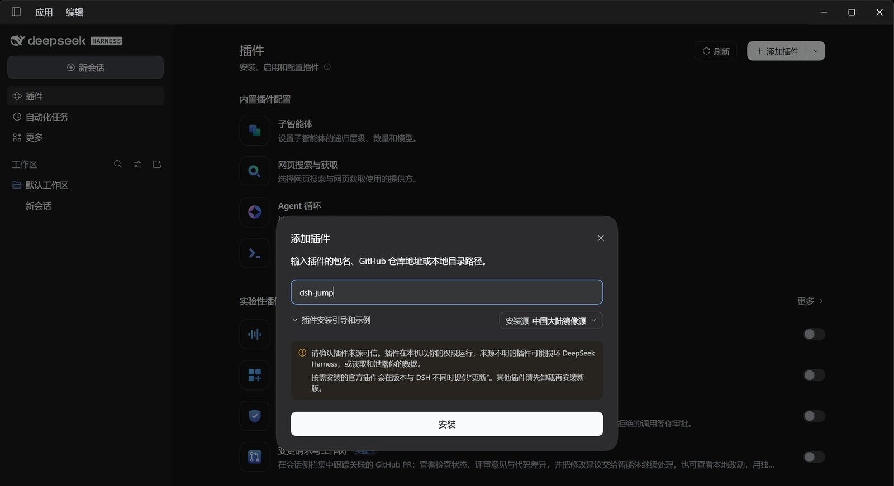

# dsh-jump


Keyboard jump navigation for the DeepSeek Harness Web GUI: press the click or
focus chord, type a letter label, and the labelled element is clicked or
focused.

[](https://www.npmjs.com/package/dsh-jump)
[](./LICENSE)
[](https://github.com/topics/dsh-plugin)

[](https://dsh.fish/a/dsh-jump)
[](https://dsh-plugin.org/plugins/lionad-morotar/dsh-jump)
[](https://dshopen.org/plugins/dsh-jump)


[中文](#中文) · [Install](#install) · [What gets labelled](#what-gets-labelled) · [How labels are assigned](#how-labels-are-assigned) · [Performance](#performance-on-a-busy-page) · [v1 boundaries](#v1-boundaries) · [Layout](#layout)

## Install

### From npm

```
dsh plugin --profile web add dsh-jump
```

Then restart the profile: the bundle patch registers the Loader row, so no
manual `cordis.patch.yml` edit is needed. The plugin manager UI works too:
open Plugins, click Add plugin, type `dsh-jump`, and confirm.



### From a checkout

To track this repository instead of the published version:

```json
{
  "dependencies": {
    "dsh-jump": "link:../dsh-jump"
  },
  "dsh": {
    "profile": {
      "bundles": ["...", "dsh-jump"]
    }
  }
}
```

Then `dsh plugin --profile web install` and restart DSH. The path in `link:`
resolves relative to `~/.dsh/profiles/web`, so adjust it to wherever the
checkout lives on your machine. Pointing at a git URL works too:
`dsh plugin --profile web add github:Lionad-Morotar/dsh-jump`.

### Manual patch

Append to the profile's `cordis.patch.yml`:

```yaml
- insert:
    - id: jump
      name: 'dsh-jump'
```

The top level of that file must always stay a YAML array (`[]` when empty).

## 中文

给 DeepSeek Harness Web GUI 的键盘跳跃导航：按下和弦后，视口里的可交互元素会被打上
字母标签，再敲标签即可点击或聚焦到它。

- 点击模式出厂绑 `Cmd+H`（非 Mac 上是 `Ctrl+H`），`Esc` 退出。
- 聚焦模式与引用模式默认未启用，没有和弦就没有按键能打开它们；要开启就进
  「设置 → 跳跃导航」，点该行快捷键再按一个组合键。
- 安装与各项行为细节见英文各节：[Install](#install)、
  [What gets labelled](#what-gets-labelled)、
  [How labels are assigned](#how-labels-are-assigned)、
  [Click versus focus is decided by the target](#click-versus-focus-is-decided-by-the-target)、
  [Reference mode](#reference-mode)、[v1 boundaries](#v1-boundaries)。

## Compatibility

`engines.dsh` is `>=0.2.0-rc.2 <0.3.0-0`. Prereleases participate in the
range, so 0.2 release candidates pass and 0.3 does not.

## Display metadata

The plugin manager takes the title and one-line description from
`locale/en.json` and `locale/zh.json`, and the icon from
`exports["./icon"]`. `assets/icon-180.png` is the same artwork at 180px for
GitHub-hosted catalog entries, which reject SVG.

## What gets labelled

Three families:

- Native controls (`a[href]`, `button`, `input`, `select`, `textarea`,
  `summary`) plus anything with a `tabindex`.
- ARIA widget roles the Harness actually renders: `button`, `link`, `tab`,
  `treeitem` (the sidebar's project and session rows), `option`, the
  `menuitem*` family, `checkbox`, `radio`, `switch`, `slider`, `spinbutton`.
  Structural roles (`row`, `columnheader`, `gridcell`) are deliberately
  absent: a row is a container and a header is a label, so labelling them
  hands dead labels to presentational tables, and an interactive grid marks
  its cells with `tabindex`, which the first family already catches.
- Editable hosts (`[contenteditable]:not([contenteditable=false])`) and the
  text-entry roles `textbox` / `searchbox` / `combobox`. This is what makes
  the composer reachable: it is a Lexical-managed
  `div[contenteditable=true][role=textbox]` with no `tabindex`, so no native
  selector matches it. `contenteditable=false` is excluded because Lexical
  marks chips and command tokens with it, and the deepest-candidate rule
  would let a chip steal the label from the composer that owns it.

## How labels are assigned

Labels follow the eye, not the DOM. Candidates are clustered into rows by
vertical overlap, rows are ordered top to bottom, and each row is consumed
left to right, so a row rendered right-to-left in the markup still reads `as`,
`ad` from the left edge. The first nine labels are `a s d f g h j k l`; past
nine the whole round switches to equal-length two-key labels (`as`, `ad`, ...)
so a short label cannot steal the first stroke of a longer one, and past 81 to
three-key.

An element keeps the label it had last round. After each round the plugin
records which label each element carried, keyed by the element's identity (an
explicit `data-row-key`, the composer marker, or a `data-slot` boundary plus
the control's accessible name and tag). The next round hands a remembered
label back to its element first, and the remaining labels fill the gaps, so a
button that appears above the one you use does not push its label onto a
neighbour.

Memory is spent only when it is unambiguous: a remembered label is ignored
when its length differs from the round's label length, and when two
candidates share one identity both are dropped rather than guessed. The table
holds 64 entries for the current page load and evicts the entry that has gone
longest without a hit. It is never written to `localStorage` or
`sessionStorage`, so a reload starts with no memory.

## Click versus focus is decided by the target

Both activation modes jump to the same set, and the matched element decides
what "jumping" means. Click mode ships bound; focus mode ships unbound, so a
reader who wants it records a chord on its settings row first:

- Text entry surfaces (textarea, caret-bearing inputs, contenteditable hosts)
  are focused, and the caret is collapsed to the end of the draft so the next
  keystroke continues writing. A field that already owns the caret keeps its
  offset.
- Everything else gets the full synthetic pointer/mouse/click sequence in
  click mode, and a plain `focus()` in focus mode.

The split is not stylistic: synthetic pointer and mouse events are untrusted,
so the browser runs no default focusing for them (dispatching the whole
sequence at a button, an input and a contenteditable element left
`activeElement` unchanged in all three cases), while a focused button does
nothing. Mode therefore only picks the fallback; the target picks the action.

Labels are rendered as an overlay by the client entry; while jump mode is
active all keydown events are consumed by the state machine, so typing inside
a focused input never leaks through.

Activation blurs the focused element before it collects labels, so the next
letter is a label even when the chord was pressed inside a text field. On
macOS the host process also remembers the current input source, switches to
`com.apple.keylayout.ABC` for the round, and switches back on Escape, on a
completed label, or when the plugin unloads. The page cannot do this itself:
it asks the host over `POST /api/dsh-jump/ime`, and the host runs
`im-select`. A missing binary or a host without a web server skips the switch
and labels still appear. `im-select` is a machine dependency, not a package
one: install it yourself with `brew install im-select`.

## Reference mode

A third activation mode, off by default. It uses the same label round as the
other two, but picking a label does not click and does not move focus: it
inserts a description of the element into the current session's composer as a
structured chip.

- **Off until recorded.** The mode ships unbound, so no chord is taken from
  the host on install. It is the third row of the Jump navigation settings
  section (`settings.section`, id `jump`, order 25); its chord button starts
  recording, and a "turn off reference mode" control unbinds it again.
  Restoring that row means unbinding, because it has no shipped chord to fall
  back to.
- **Nothing on the page changes.** The reference branch is checked before the
  target's own activation, so neither the synthetic click sequence nor the
  focus path runs. The element keeps whatever selection and focus it had.
- **The chip.** `clipboardText` is `[ui element button#gx-reference]` or
  `[ui element button[data-testid=gx-reference]]`; the label is
  `button「引用」`. The model text is one line of facts:
  `[ui element] <button> data-testid="gx-reference" role=button aria-label="引用" class="gx-btn" text="引用"`.
  Identity priority is `data-testid` > `id` > up to three authored classes; a
  class counts as authored when it carries a `-` or `_` and is not a utility
  word or a generated hash (`css-…`, `sc-…`, `_…`).
- **It needs a session.** The plugin is root-level, so it cannot ask which
  session is on screen. An invisible entry in `conversation.input.overlay`
  publishes `{ sessionId, inputActions }`; with no session, or on a host
  without that slot, the insert answers `no-session` and nothing is clicked.
- **Degrades, never throws.** A host without `insertReference` falls back to
  `inputActions.insertText(clipboardText)`, whose plain text is still sendable
  where a chip without a codec would be refused at send time and keep the
  draft. If neither channel accepts the write the pick is silently dropped.
  `inputTriggers`, `sessions` and `conversation` are all soft-probed, so a
  host missing any of them keeps the navigation and loses only the chip's
  send-time identity.
- **Clicking the chip goes back to the element.** The chip carries a
  description rather than a live reference, so the element is looked up again
  on every click, in the same order the description was written in:
  `data-testid` > `id` > tag plus its authored classes > `role` /
  `aria-label` > visible text. Each step is exhausted before the next one
  starts, so a stale `id` elsewhere on the page cannot beat a live test id, a
  hit is scrolled to the centre of the viewport and focused with
  `preventScroll`, and the composer is never a candidate: its text can hold
  the very words the target carried, so revealing it would scroll to the chip
  the reader just clicked. A miss answers `false` and the host keeps its own
  gesture.

## Performance on a busy page

A round costs one collection pass and one paint, and both used to grow with
the square of the page. Measured on a 1841×1274 view with 1189 visible
candidates over 25k DOM nodes, a round took 72ms to collect and 5.4ms to
repaint on every stroke of a three-key label. Neither is on the critical path
now:

- Containers are decided by ancestor marking: a candidate that contains
  another candidate is a wrapper and the deepest target wins. Walking up from
  each candidate and marking the candidates it passes costs O(n · depth)
  instead of comparing every pair, and lands on the same set. 72ms to 8ms.
- Badges are keyed by label and updated in place: the lit/dim split is a
  function of the typed prefix alone, so a badge whose prefix did not change
  is not touched, and only the few the prefix still reaches are re-segmented.
  5.4ms to 0.1ms per stroke.
- Badges share one containing block: they are `position:absolute` inside a
  `fixed; inset:0` container rather than fixed themselves, so the browser
  tracks one containing block instead of one per badge.

In-place updating leans on the snapshot rule in
[v1 boundaries](#v1-boundaries): label, target and rect are fixed when the
round opens, so only the prefix can change inside a round. A new round mints
new badges, which is what stops a label from staying over a target that has
moved since.

## v1 boundaries

- Hints are snapshotted at the moment of activation: elements that appear or
  move after activation do not get labels until you re-activate.
- The activation chords are stored per browser profile in `localStorage`
  (`dsh-jump:bindings:v1`), not in package config. The host's own shortcut
  registry cannot hold them (a bare home-row label stroke is rejected as
  modifier-less, and the shipped `Cmd+H` default collides with reserved
  primary chords), so the listener is plugin-owned and the settings page
  writes to the same plugin-owned document.
- A chord that prints a character must carry ⌘, ⌃ or ⌥: a bare letter would
  type into whatever field has focus, and Shift alone is refused for the same
  reason. A key that prints nothing (Insert, F1, Home, PageUp) may be bound
  bare; the runtime steps aside while a text surface has focus, so the editor
  keeps its own meaning of that key. Keys the interface owns (Tab, Enter,
  Space, the arrow keys, Escape) are refused at any modifier count, as is the
  chord the other mode already holds.
- The settings section waits for the host's slot service through `ctx.inject`
  rather than sampling it once: services start one at a time, so a single
  `ctx.get("slots")` during `apply` can legitimately return undefined. With
  neither the slot service nor a React seed, navigation still works; only the
  ability to remap is missing.
- Web and desktop both load this plugin, but the label overlay targets the
  Web GUI's DOM. The chords and the settings section are not Web-specific.

## Layout

- `src/index.ts` host half: serves `POST /api/dsh-jump/ime` and runs `im-select`
- `src/host/input-source.ts` one round: remember, switch to ABC, restore
- `src/host/ime-route.ts` the route, re-attached if the web server appears late
- `src/client/entry.ts` loader adapter: takes the factory's `require`, resolves
  React, then hands the real context to `runtime.ts`
- `src/client/runtime.ts` composition: one bindings store shared by the listener
  and the settings row
- `src/client/hints.ts` hint collection and label stream
- `src/client/target.ts` which action a matched target needs (click vs focus)
- `src/client/keys.ts` key state machine
- `src/client/bindings.ts` chord model, platform defaults, validation, formatting
- `src/client/store.ts` the persisted pair, total on read, normalized on write
- `src/client/recorder.ts` one keydown into a candidate chord
- `src/client/settings-controller.ts` the recording mode's rules, renderer-free
- `src/client/settings-page.ts` the settings page: one row per mode
- `src/client/react.ts` the narrowed React slice and the recording listener
- `src/client/copy.ts` the page's Chinese and English copy
- `src/client/config.ts` selectors and the label key map
- `src/client/ime.ts` the page's begin/end notice to the host route
- `lib/` committed build products (`pnpm run build`)

## Development

```sh
pnpm install
pnpm test        # vitest
pnpm typecheck   # tsc --noEmit
pnpm run build   # esbuild src -> lib, committed
```

`lib/` is committed on purpose: an installed profile loads `lib/` straight from
the package and never runs a build step, so the built files have to be in the
tarball and in the repository.

The build produces a two-entry package: `lib/index.js` is the host half (the
input-source route) and `lib/client.js` is the browser half inlined with its
React imports resolved at load time.

## Releasing

```sh
npm version <patch|minor|major>   # or edit package.json
pnpm run release                  # test, build, then publish to registry.npmjs.org
git push --follow-tags
```

`release` runs the tests and the build before publishing, so a failing suite
stops the release. Publishing goes to `registry.npmjs.org` explicitly because a
global `registry` setting elsewhere (a mirror, for instance) would otherwise
send the tarball to the wrong place while reads still succeed.
